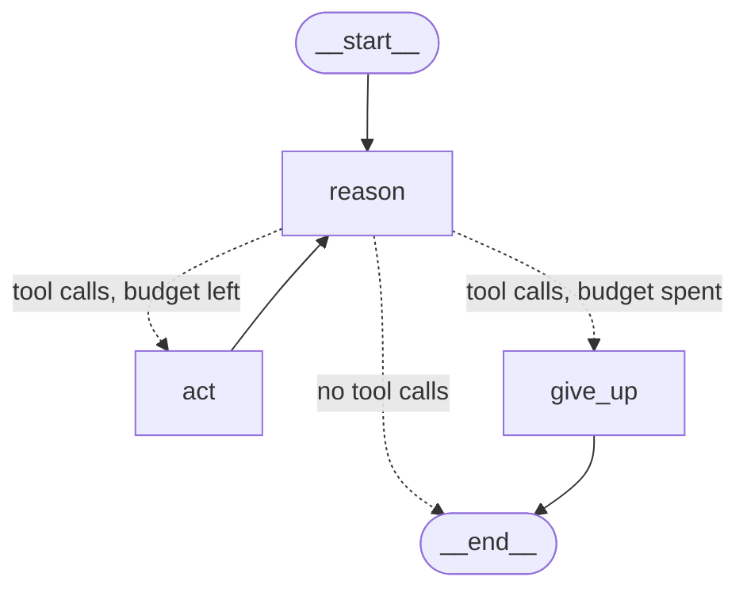

# Lesson 3 — Inside the reasoning-and-action loop

> **Outcome:** the ReAct loop from lesson 2 rebuilt by hand as a LangGraph `StateGraph` — `reason` and `act` nodes, a routing function, a per-turn step budget, and handling for a tool the model invents — so you can see and control every step.

## Learning objectives

- Express the reason → act → observe cycle as graph nodes and a conditional edge.
- Bind tools to a model (`bind_tools`) and run the model's tool calls yourself, through vdreamer governance (`ctx.tools.govern`).
- Stop a runaway loop gracefully with a step budget, and know how that differs from LangGraph's `recursion_limit`.
- Keep the conversation history valid: every tool call gets exactly one `ToolMessage`.
- Read a run's event trace and map each event to a step of the loop.

## Prerequisites

- [Lesson 2](../t02_minimal_react_agent/README.md): `create_agent`, model aliases, `@vdreamer.tool`.
- [Lesson 1](../t01_serving_an_agent/README.md): `StateGraph`, nodes, `add_messages`.

## Concepts

`create_agent` hides a small graph. Building it yourself shows three facts that matter later:

1. **The model does not run tools.** A model reply is an `AIMessage`; when it wants to act, its `tool_calls` list holds `{"name", "args", "id"}` entries. *Your* code runs them and appends one `ToolMessage` per call, tied to it by `tool_call_id`.
2. **"Observe" is just the next prompt.** The `ToolMessage`s become part of the message list, and the next model call reads them. There is no hidden memory: what the model knows is what is in the prompt.
3. **The loop needs a stop condition you control.** A confused model can call tools forever. Each model call costs time and money, so a production loop has a budget.

LangGraph has its own safety net, the **recursion limit**: a cap on *supersteps* (one per node execution — `reason`, `act`, `reason`, …), 25 by default. Hitting it raises `GraphRecursionError` and the run **fails**. A step budget in your graph instead ends the turn *gracefully* with a message the user can act on. Use both: the budget for the expected case, the limit as a backstop. A client can lower the limit per run with `{"input": …, "config": {"recursion_limit": 10}}`.

## What comes from where

| Piece | Provided by |
| --- | --- |
| `StateGraph`, `add_conditional_edges`, `END`, recursion limit | LangGraph |
| `bind_tools`, `AIMessage.tool_calls`, `ToolMessage` | LangChain (`langchain_core`) |
| `ctx.tools.govern([...])` — governed proxies with the same name and schema | vdreamer |
| `tool.call` / `tool.result` events from governed calls | vdreamer |
| The step budget, unknown-tool handling | this lesson's code |

## How it works



For "Compare orders A1001 and A1003", one run is seven supersteps: `reason` (call A1001) → `act` → `reason` (call A1003) → `act` → `reason` (answer). The event trace shows exactly that:

```
run.status        running
message.completed ai: ''                              ← reason: a tool-call message
tool.call         get_order_status({'order_id': 'A1001'})   ← act
tool.result       ok: Order A1001: shipped on 2026-10-01, arriving 2026-10-04
message.completed ai: ''                              ← reason again, having observed A1001
tool.call         get_order_status({'order_id': 'A1003'})
tool.result       ok: Order A1003: delivered on 2026-09-28
message.completed ai: 'A1001 is on its way; A1003 was delivered on 28 September.'
run.status        completed
```

## Step by step

**1. Govern the tools and bind them to the model.** `ctx.tools.govern` returns proxies with the same names and schemas that run each call through vdreamer's pipeline (events, timeouts, containment — lesson 5). `bind_tools` tells the model which tools exist.

```python
# file: agent.py
        tools = ctx.tools.govern([get_order_status])  # governed: events, timeouts, containment
        tools_by_name = {tool.name: tool for tool in tools}
        model = ctx.models["chat"].bind_tools(tools)  # the model sees the tools' schemas
```

In a hand-written graph, governing is your job. `vdreamer validate` checks LangGraph `ToolNode`s, but it cannot see tools called from inside your own node function (it reports `tools.governed: (no tool nodes)`). An ungoverned tool that raises fails the whole run, with its raw error message — secrets included — sent to the client; lesson 5 shows the difference.

**2. Reason.** One model call over the system prompt and the whole conversation.

```python
# file: agent.py
        async def reason(state: State) -> dict[str, Any]:
            """Reason: the model reads the conversation and answers or asks for tools."""
            response = await model.ainvoke([SystemMessage(SYSTEM_PROMPT), *state["messages"]])
            return {"messages": [response]}
```

**3. Act and observe.** Run every requested tool. Invoking a governed tool with the model's tool-call dict returns a `ToolMessage` carrying the right `tool_call_id`. A tool the model made up gets an error observation instead of crashing the run:

```python
# file: agent.py
            for tool_call in request.tool_calls:
                tool = tools_by_name.get(tool_call["name"])
                if tool is None:  # the model asked for a tool that does not exist
                    observations.append(ToolMessage(
                        f"Error: there is no tool named {tool_call['name']!r}.",
                        tool_call_id=tool_call["id"], status="error",
                    ))
                    continue
                observations.append(await tool.ainvoke(tool_call))
            return {"messages": observations}
```

**4. Route.** After each `reason`, decide: answer, act, or give up.

```python
# file: agent.py
        def after_reasoning(state: State) -> Literal["act", "give_up", "__end__"]:
            last = state["messages"][-1]
            if not isinstance(last, AIMessage) or not last.tool_calls:
                return END  # no tool calls: the model has answered
            if steps_this_turn(state["messages"]) >= MAX_STEPS:
                return "give_up"
            return "act"
```

**5. Count steps per turn, not per thread.** The thread keeps every earlier turn, so a counter stored in state would keep growing across turns. Counting model replies since the latest user message resets naturally:

```python
# file: agent.py
def steps_this_turn(messages: Sequence[AnyMessage]) -> int:
    """Model replies since the latest user message (the thread keeps earlier turns)."""
    steps = 0
    for message in reversed(messages):
        if isinstance(message, HumanMessage):
            break
        if isinstance(message, AIMessage):
            steps += 1
    return steps
```

**6. Give up cleanly.** The last model reply asked for tools that will not run. OpenAI-compatible servers reject a history in which a tool call has no answer, so `give_up` answers each one before apologising:

```python
# file: agent.py
            skipped = [
                ToolMessage("Skipped: the step budget ran out.", tool_call_id=call["id"],
                            status="error")
                for call in request.tool_calls
            ]
```

**7. Wire the graph.**

```python
# file: agent.py
        graph = StateGraph(State)
        graph.add_node("reason", reason)
        graph.add_node("act", act)
        graph.add_node("give_up", give_up)
        graph.add_edge(START, "reason")
        graph.add_conditional_edges("reason", after_reasoning, ["act", "give_up", END])
        graph.add_edge("act", "reason")  # observe, then reason again
        graph.add_edge("give_up", END)
        return graph
```

## The complete example

[`agent.py`](agent.py) — `ReactLoopAgent` (`t03-react-loop`), the same order data and tool as lesson 2, and `MAX_STEPS = 4`.

## Run it

From `tutorials/`, with a model server as in lesson 2:

```bash
uv run vdreamer dev --registry vdreamer.yaml --agent t03-react-loop --models config/models.ollama.yaml
uv run vdreamer run t03-react-loop --message "Compare orders A1001 and A1003"
```

To see LangGraph's recursion limit fail a run, start one over HTTP with a low limit:

```bash
curl "${H[@]}" -X POST http://127.0.0.1:8000/api/v1/threads/<thread_id>/runs \
     -d '{"input": {"messages": [{"role": "user", "content": "Check A1001"}]}, "config": {"recursion_limit": 2}}'
```

## Expected behavior

`vdreamer run` shows two `-> get_order_status(...)` lines (or one line per order if your model calls tools in parallel — both are valid ReAct behavior) and then the answer. With `recursion_limit: 2` the run ends `failed` with `node_error: Recursion limit of 2 reached without hitting a stop condition…`. A model stuck calling tools gets `MAX_STEPS` model calls and then the reply "I could not finish this within 4 steps…" — the run still *completes*.

## Test it

[`test_t03_react_loop.py`](../../../../tests/tutorials/test_t03_react_loop.py) scripts each path: two sequential cycles, parallel calls, the runaway loop, a multi-turn thread, an invented tool, and the recursion limit. The key assertion is about what the model *saw* at each step:

```python
# file: tests/tutorials/test_t03_react_loop.py
    observed = [[m.text for m in prompt if isinstance(m, ToolMessage)] for prompt in model.prompts]
    assert observed == [
        [],
        ["Order A1001: shipped on 2026-10-01, arriving 2026-10-04"],
        ["Order A1001: shipped on 2026-10-01, arriving 2026-10-04",
         "Order A1003: delivered on 2026-09-28"],
    ]
```

And the budget test checks the history is still valid after giving up:

```python
# file: tests/tutorials/test_t03_react_loop.py
    assert model.calls_made == MAX_STEPS
    assert result.answer.startswith(f"I could not finish this within {MAX_STEPS} steps")
```

```bash
uv run pytest tests/tutorials/test_t03_react_loop.py -v -s     # -s prints the trace
```

## Common mistakes and debugging

- **Raw tools in your own node** — `validate` cannot detect them in a function node (`tools.governed: (no tool nodes)`), and the first exception fails the run. Bind and call the list `ctx.tools.govern(...)` returns.
- **A step counter stored in state** keeps counting across turns on the same thread, so the second question fails immediately. Derive per-turn values from the messages, or reset them in an entry node.
- **A `400` on the *next* turn saying an assistant message with tool calls must be followed by tool messages** (wording varies by server) — some tool call in the history has no `ToolMessage`. Answer every call, even when skipping it.
- **`KeyError` on an unknown tool name** — models do invent tools, especially small ones. Return an error observation and let the model recover.
- **Calling `tool.ainvoke(tool_call["args"])`** — with bare arguments, the tool returns its plain output, not a `ToolMessage`, and you must build the message (and its `tool_call_id`) yourself. Passing the whole tool-call dict is simpler.
- **The run fails with `Recursion limit of 25 reached`** — your stop condition never fired. Print the trace (`result.trace()` in tests) to see the loop.

## Design trade-offs

- **Hand-built vs. `create_agent`.** The graph is ~60 lines instead of ~6, and you now own parallel execution, unknown tools and stop conditions. You gain the ability to add steps (validation, approval, logging) exactly where you want them. `create_agent` covers most of these with middleware (`ToolCallLimitMiddleware`, `ModelCallLimitMiddleware` — lessons 9 and 24).
- **Sequential tool execution.** `act` runs a turn's tool calls one after another, which keeps the code obvious. For slow, independent tools, run them concurrently (`asyncio.gather`) — `create_agent`'s tool node already does.
- **Budget size.** Too small and legitimate multi-step questions fail; too large and a confused model burns time. Measure the number of steps real questions need and add headroom.

## Exercises

1. Run the tool calls of one turn concurrently with `asyncio.gather` and keep the tests green.
2. Make the budget configurable per agent instance (`ReactLoopAgent(max_steps=6)`) and register a second agent with a larger budget.
3. Add a `log` event in `act` for every tool the model asks for that does not exist (`vdreamer.emit_log(..., level="warning")`).
4. Write a test where the model asks for the same order twice in one turn and decide whether `act` should de-duplicate.

Next: [Lesson 4 — Defining and integrating a custom tool](../t04_custom_tool/README.md).
